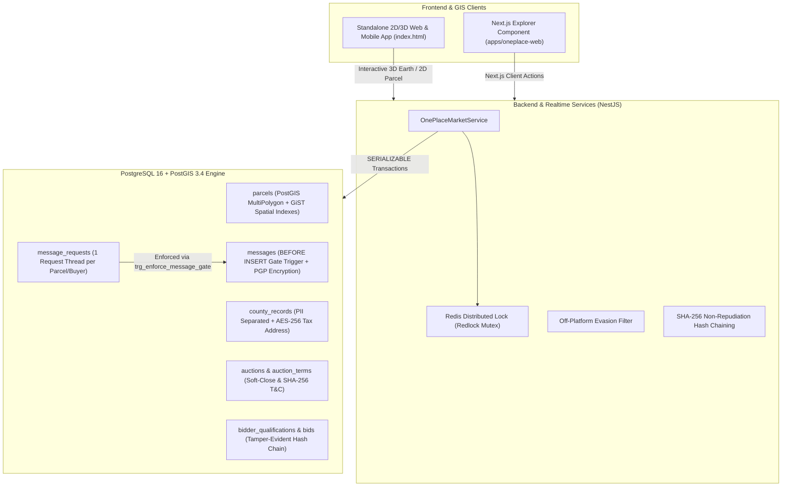

# One Place — US Parcel GIS, County Records, Request-Gated Offers & Property Bidding

[](https://www.postgresql.org/)
[](https://postgis.net/)
[](https://nestjs.com/)
[](https://nextjs.org/)
[](https://www.typescriptlang.org/)
[](LICENSE)

**One Place** is a secure, high-concurrency real estate marketplace and geospatial intelligence platform. It bridges county assessor records, PostGIS boundary polygons, verified ownership claims, request-gated buyer/owner negotiations, and anti-sniping live property auctions with cryptographic non-repudiation audit trails.

---

## 🏛 Platform Architecture



---

## 📂 Codebase Structure

```
Oneplace/
├── database/
│   └── schema.sql                 # PostgreSQL 16 + PostGIS 3.4 DDL, spatial indexes & triggers
├── services/
│   └── oneplace-api/
│       └── src/
│           └── market/
│               └── oneplace-market.service.ts # NestJS service with TypeORM & Redis
├── apps/
│   └── oneplace-web/
│       └── src/
│           └── components/
│               └── OnePlaceExplorer.tsx       # Next.js React client component
├── index.html                     # Complete standalone 2D/3D Web & Mobile GIS application
├── package.json                   # Project scripts and metadata
├── .gitignore                     # Git hygiene rules
└── README.md                      # Comprehensive documentation
```

---

## ⚙️ Core Technical Capabilities

### 1. Spatial GIS & Sub-50ms Parcel Queries (`database/schema.sql`)
- **PostGIS 3.4 MultiPolygon Geometry**: Full parcel lot boundaries stored as `GEOMETRY(MultiPolygon, 4326)` with precomputed `Point` centroids.
- **GiST Spatial Indexing**: Sub-50ms viewport queries on `idx_parcels_geom` and `idx_parcels_centroid` for Google Maps and 3D Earth tiles.
- **Assessor Data & PII Isolation**: Confidential tax mailing addresses encrypted with `AES-256-GCM` (`BYTEA`) and separated into `county_records`.

### 2. Request-Gated Messaging Database Trigger
Messaging is locked at the database layer until the verified owner transitions the offer status to `ACCEPTED`:
```sql
CREATE OR REPLACE FUNCTION enforce_message_request_gate()
RETURNS TRIGGER AS $$
DECLARE
    req_status request_gate_status;
BEGIN
    SELECT status INTO req_status
    FROM message_requests
    WHERE id = NEW.message_request_id;

    IF req_status IS DISTINCT FROM 'ACCEPTED' THEN
        RAISE EXCEPTION 'ONE_PLACE_SECURITY_GATE: Messaging is locked until the property owner accepts the request.';
    END IF;

    RETURN NEW;
END;
$$ LANGUAGE plpgsql;

CREATE TRIGGER trg_enforce_message_gate
BEFORE INSERT ON messages
FOR EACH ROW
EXECUTE FUNCTION enforce_message_request_gate();
```

### 3. NestJS Market Engine (`OnePlaceMarketService`)
- **Workflow 1: Owner Decision**: Strict ownership verification against `parcels.verified_owner_user_id` before unlocking negotiations.
- **Workflow 2: PGP-Encrypted In-Thread Messaging**: Automatic regex sanitization of phone numbers and emails (`[PHONE REDACTED BY ONE PLACE SECURITY]`) to prevent off-platform escrow evasion, followed by `pgp_sym_encrypt`.
- **Workflow 3: Cryptographic Bidder Qualification**: Validates the SHA-256 hash of agreed terms against `auction_terms.terms_sha256_hash` and confirms entry fee authorization ($5,000 hold via Stripe / Plaid).
- **Workflow 4: Atomic Bidding & Anti-Sniping**:
  - Redis distributed mutex lock per auction (`NX`, `PX: 5000`).
  - `SERIALIZABLE` PostgreSQL transaction isolation.
  - Anti-shill rule: Property owners cannot bid on their own auctions.
  - Anti-sniping soft close: If a bid is submitted within `soft_close_window_seconds` (last 3 minutes), `ends_at` automatically extends by `soft_close_extension_seconds` (+3 minutes).
  - Tamper-evident SHA-256 hash chaining: Each bid records `prev_bid_hash` linked to `record_hash`.

### 4. Standalone 2D/3D Interactive Application (`index.html`)
- **Dual Device Experience**: Instant toggle between full-bleed **Web App** and framed **Mobile App** (complete with Dynamic Island, Status Bar, Bottom Nav, and Peek/Half/Full Sheet drawer controls).
- **Dual Role Perspectives**: Switch between **Buyer View** (with $4.5M verified Proof of Funds) and **Verified Owner View** to test incoming offer reviews and auction publishing.
- **Live 3D Canvas**: Real-time rendering of 3D extruded building models, parcel boundary polygons, centroid beacon pins, orbital rotation, tilt control, and touch/mouse interaction.
- **Live Bidding & Slide-to-Bid**: Interactive slider to commit bids, simulated competing institutional bids, and real-time audit ledger inspection.

---

## 🚀 Quickstart & Local Setup

### 1. View the Standalone Application
Open `index.html` directly in any modern browser:
```bash
# Using Python
python -m http.server 3000

# Using Node.js
npx serve .
```
Navigate to `http://localhost:3000` to interact with the full 2D/3D parcel map, gated offers, and bidding engine.

### 2. Apply Database Schema
Ensure PostgreSQL 16 with PostGIS 3.4 is running:
```bash
createdb oneplace
psql -d oneplace -f database/schema.sql
```

### 3. Integrate Backend Service
Install dependencies in your NestJS application:
```bash
npm install @nestjs/common typeorm ioredis
```
Import `OnePlaceMarketService` into your NestJS module and configure your `DataSource` and `Redis` provider.

---

## 🔒 Security & Compliance

| Mechanism | Description | Layer |
| :--- | :--- | :--- |
| **Gated Offer Trigger** | Blocks message insertion until owner accepts | PostgreSQL PL/pgSQL |
| **Contact Redaction** | Strips off-platform phone numbers and email leaks | Application (NestJS / UI) |
| **Message Ciphertext** | In-flight encrypted payloads via symmetric PGP | Database / API |
| **Terms Non-Repudiation** | Strict SHA-256 hash matching of terms text | Backend Service |
| **Audit Hash Chaining** | Blockchain-style `prev_bid_hash -> record_hash` log | PostgreSQL & Redis |
| **Distributed Mutex** | Redis lock prevents race conditions on concurrent bids | Distributed Cache |

---

## 📄 License
This project is licensed under the MIT License — see the [LICENSE](LICENSE) file for details.
